<h1 align="center">🐉 Kali Linux Pentest Lab on VirtualBox</h1>

<p align="center"><i>A private, isolated virtual network where I can safely learn ethical hacking.</i></p>

<p align="center">
  
  
  
  
</p>

> **Networkwalks Cybersecurity Internship** · Week 1 · Task `WK1-PM1`
> **Intern:** Piyush Sonawane · **Batch:** B084B

---

## 📑 Contents

1. [At a glance](#-at-a-glance)
2. [Why I built this lab](#-why-i-built-this-lab)
3. [Network design](#-network-design)
4. [Build log](#-build-log)
5. [Test results](#-test-results)
6. [Troubleshooting](#-troubleshooting)
7. [Key takeaways](#-key-takeaways)
8. [Ethical use](#-ethical-use)
9. [Repository layout](#-repository-layout)
10. [Author](#-author)

---

## ⚡ At a glance

| | |
| :-- | :-- |
| **Host** | Windows 11 · 16 GB RAM · Intel Core i5 (12th Gen) |
| **Hypervisor** | VirtualBox |
| **Attacker VM** | Kali Linux 2026.3 (pre-built amd64 image) |
| **VM resources** | 4096 MB RAM · 2 CPUs · ~80 GB dynamic disk |
| **Virtual network** | NAT Network `NatNetwork` · `10.0.0.0/24` · DHCP on |
| **Kali address** | `10.0.0.2/24` (static) · gateway `10.0.0.1` · DNS `8.8.8.8` |
| **Extras** | Bidirectional clipboard & drag-and-drop · shared Downloads folder · snapshot |

---

## 🧭 Why I built this lab

Practising security tools on real systems is illegal and risky, so I needed a sandbox of my own. This lab gives me a Kali Linux machine on a private network that I fully control. Later I can add vulnerable target machines next to it and use it for:

- 🔭 Network reconnaissance and port scanning
- 🧪 Vulnerability assessment
- 📦 Packet capture and analysis
- 🌐 Web application testing
- 🧰 Learning and comparing security tools

---

## 🗺️ Network design

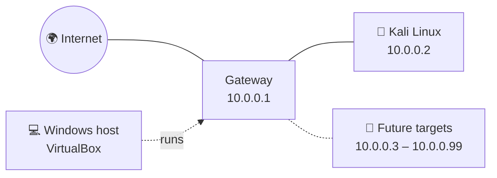

**IP plan**

| Range | Purpose |
| :-- | :-- |
| `10.0.0.1` | NAT Network gateway |
| `10.0.0.2` | Kali Linux (static) |
| `10.0.0.3 – 10.0.0.99` | Reserved for future lab VMs |

A **NAT Network** (rather than a plain NAT) was the right pick: VMs on it can see each other and still reach the Internet, which is exactly what a multi-machine lab needs.

---

## 🛠️ Build log

### Phase 1 · Get the tools

**7-Zip** is required to unpack the compressed Kali image, so I downloaded version 26.05 from the official site.

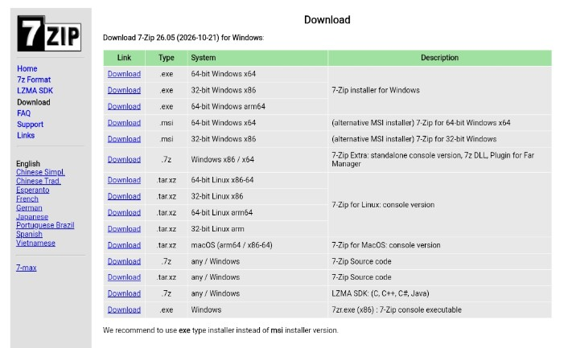

Then I downloaded **VirtualBox** from its official site and installed it with the default options.

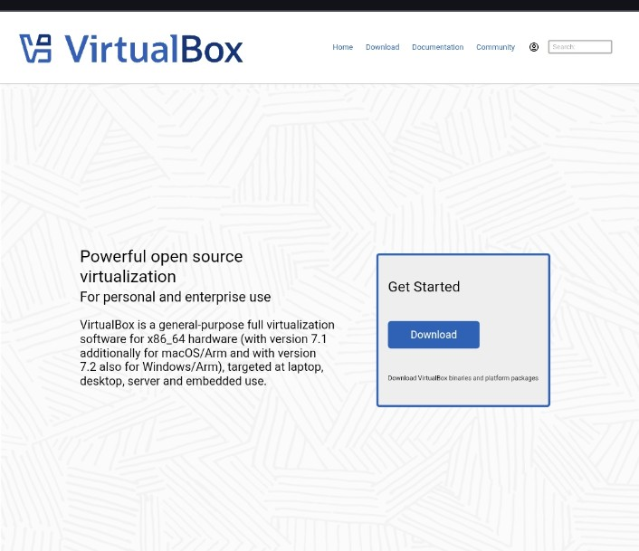

### Phase 2 · Create the virtual network

In VirtualBox's **Network** manager → **NAT Networks** tab, I configured:

```text
Name:         NatNetwork
IPv4 prefix:  10.0.0.0/24
DHCP:         enabled
IPv6:         disabled
```

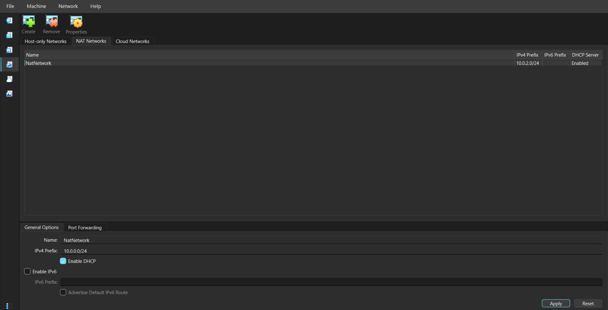

### Phase 3 · Get and import Kali

On kali.org I selected **Virtual Machines**, then the **VirtualBox** image.

<p align="center">
  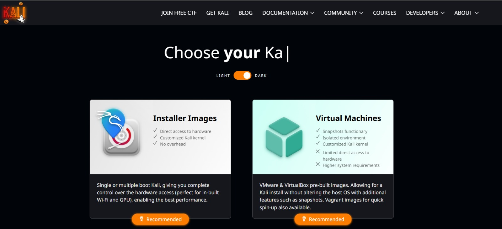
  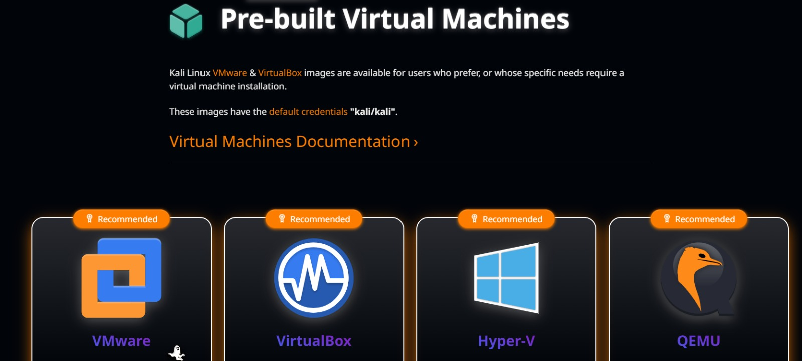
</p>

I extracted the archive with 7-Zip and opened the `.vbox` file, which registered `kali-linux-2026.3-virtualbox-amd64` in VirtualBox.

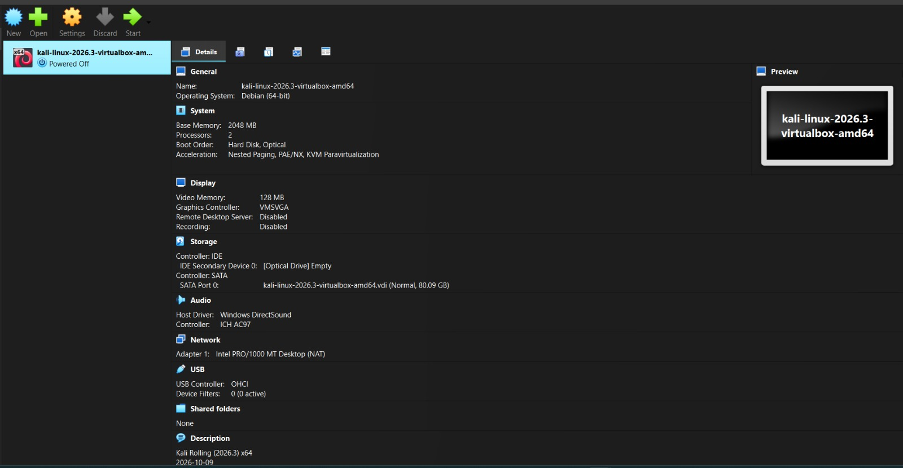

### Phase 4 · Tune the VM (powered off)

<details open>
<summary><b>4a. Network adapter</b></summary>

```text
Attached to:       NAT Network  →  NatNetwork
Adapter type:      Intel PRO/1000 MT Desktop (82540EM)
Promiscuous mode:  Allow All
Virtual cable:     connected
```

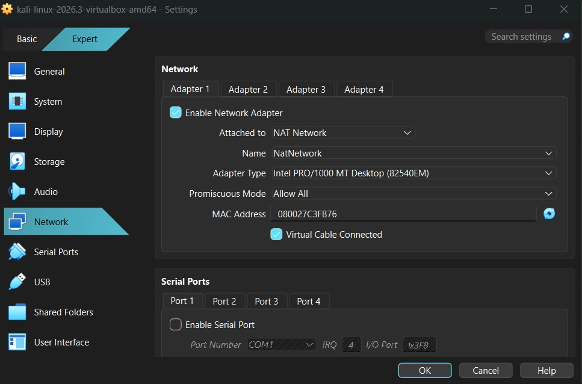
</details>

<details open>
<summary><b>4b. Clipboard, drag-and-drop and memory</b></summary>

**General → Features:** Shared Clipboard and Drag-and-Drop both set to *Bidirectional*.
**System → Motherboard:** base memory raised to *4096 MB*.

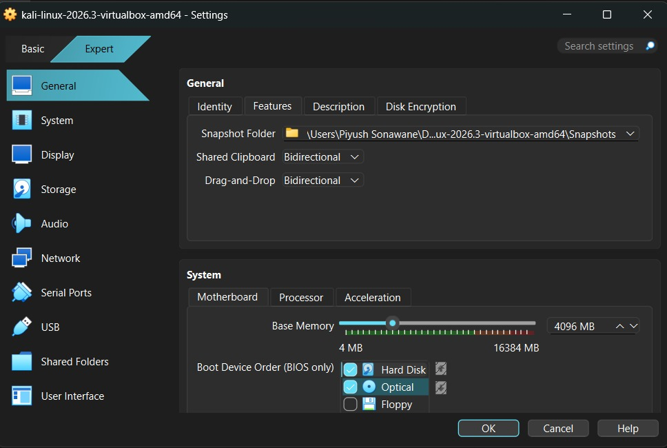
</details>

<details open>
<summary><b>4c. Display</b></summary>

Graphics controller left on VMSVGA with 3D acceleration enabled.

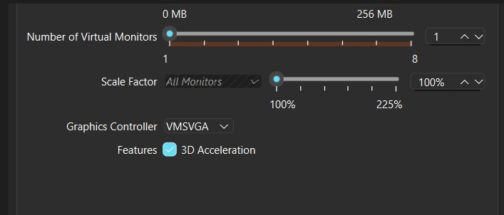
</details>

<details open>
<summary><b>4d. Shared folder</b></summary>

Host `Downloads` folder shared with *Full* access and *Auto Mount* on. Inside Kali it shows up at `/media/sf_Downloads`.

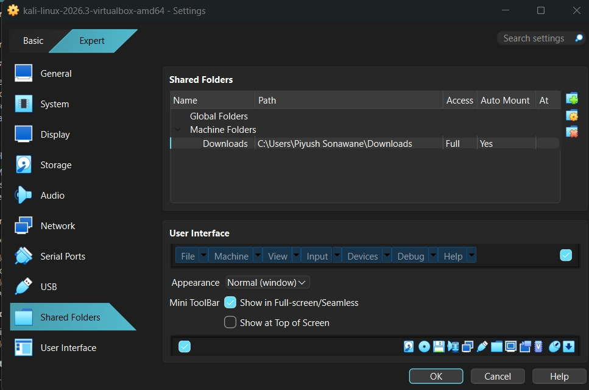
</details>

### Phase 5 · Boot Kali and set a static IP

I started the VM and signed in with the default `kali` user.

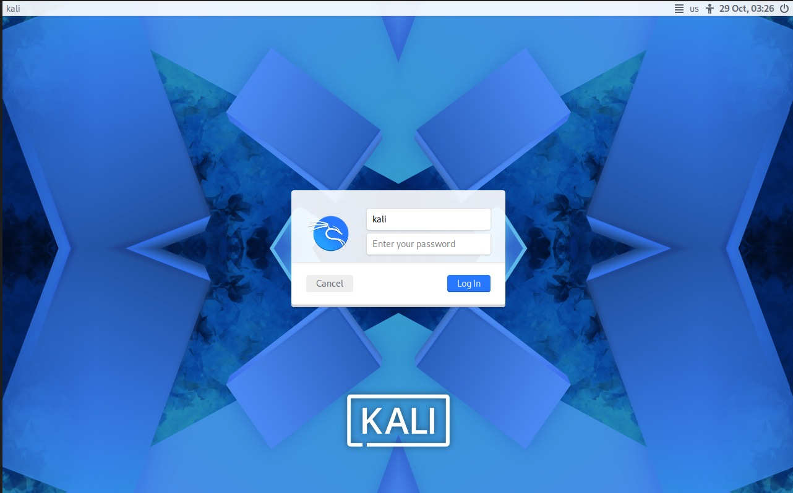

**Option A: graphical.** In *Wired connection 1 → IPv4 Settings* I switched the method to **Manual**:

| Address | Netmask | Gateway | DNS |
| :-- | :-- | :-- | :-- |
| `10.0.0.2` | `24` | `10.0.0.1` | `8.8.8.8` |

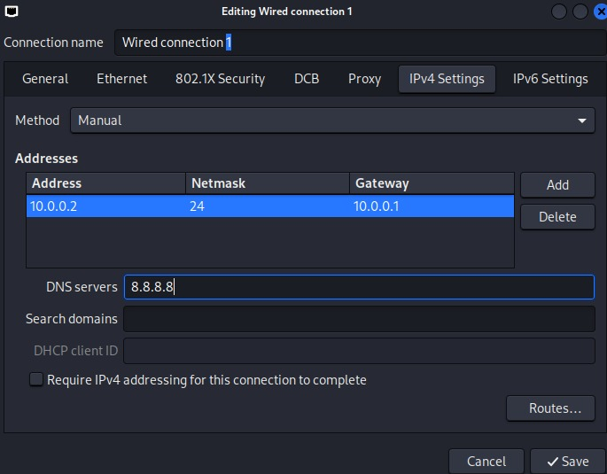

**Option B: terminal.** The same result with `nmcli`:

```bash
sudo nmcli connection modify "Wired connection 1" \
  ipv4.method manual \
  ipv4.addresses 10.0.0.2/24 \
  ipv4.gateway 10.0.0.1 \
  ipv4.dns 8.8.8.8 \
  ipv4.dad-timeout 0

sudo nmcli connection down "Wired connection 1"
sudo nmcli connection up   "Wired connection 1"
```

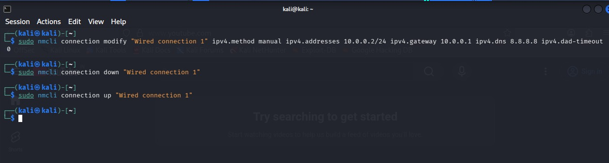

A fixed address keeps the lab predictable and makes later exercises easier to document.

### Phase 6 · Save a snapshot

With the network working, I took a VirtualBox snapshot (*Machine → Take Snapshot*) named **start**, with the description *network modification*. It lets me roll back instantly after any experiment that goes wrong.

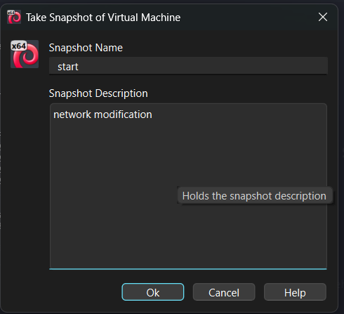

---

## ✅ Test results

- [x] **IP address:** `ip a` shows `10.0.0.2/24` on `eth0`
- [x] **Gateway:** `ping -c 4 10.0.0.1` → 4/4 replies, 0% loss
- [x] **Internet by IP:** `ping -c 4 8.8.8.8` → 4/4 replies, 0% loss
- [x] **DNS:** `ping -c 4 google.com` → the name resolved and all 4 pings were answered, 0% loss

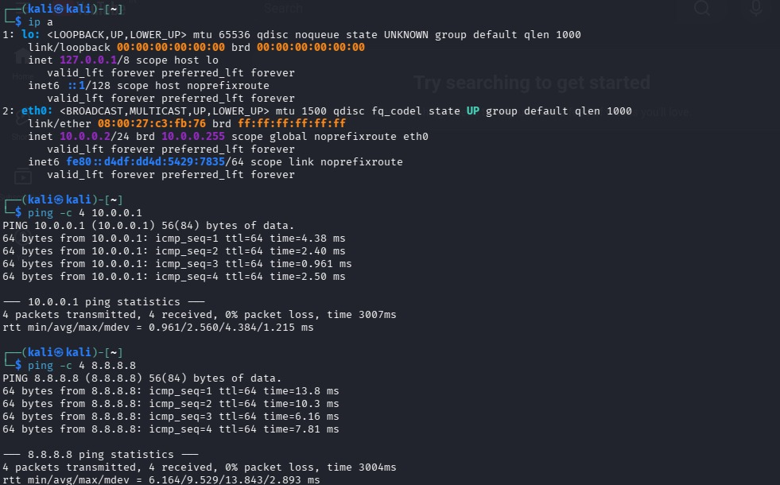

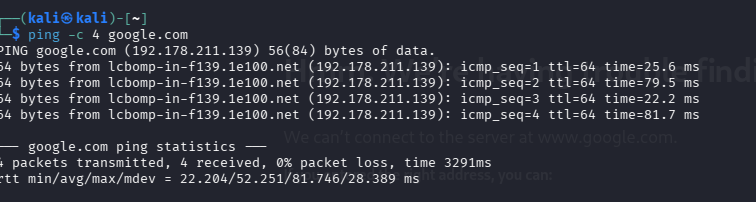

---

## 🩺 Troubleshooting

Problems to watch for with this setup, and their fixes:

<details>
<summary>Kali has no Internet after setting the static IP</summary>

Re-run the `nmcli` commands from Phase 5 (the `ipv4.dad-timeout 0` option matters), reboot Kali, and if needed try `10.0.0.1` as the DNS server.
</details>

<details>
<summary>The adapter says "NAT" instead of "NAT Network"</summary>

In VM **Settings → Network**, set *Attached to* to **NAT Network** and choose `NatNetwork`.
</details>

<details>
<summary>The NAT Network list still shows the old prefix</summary>

After typing `10.0.0.0/24`, click **Apply** and confirm the list above has updated.
</details>

<details>
<summary>Two VMs have the same IP</summary>

Make sure no other VM on the NAT Network is using `10.0.0.2`.
</details>

<details>
<summary>"Permission denied" on the shared folder</summary>

Run `sudo usermod -aG vboxsf kali` and reboot.
</details>

> 💡 Connection names can differ between systems. Check yours with `nmcli connection show` before running the commands.

---

## 🧠 Key takeaways

- **NAT vs NAT Network.** Plain NAT isolates each VM; a NAT Network lets them talk to each other and still go online.
- **VM networking is sensitive.** One adapter setting decides whether the whole lab works.
- **Static addressing.** I set and verified IP, netmask, gateway and DNS both in the GUI and with `nmcli`.
- **Snapshots are a safety net.** A snapshot makes it painless to experiment.
- **Documentation matters.** Notes and screenshots make a project repeatable for me and for others.

---

## ⚖️ Ethical use

> **This lab is for education and authorized practice only.**
> Testing is legal only on systems you own or have written permission to test. Everything in this project was done inside my own isolated lab.

---

## 📁 Repository layout

```text
.
├── README.md
├── Screenshots-Gallery.pdf
└── screenshots/
    ├── 01-7zip.jpg
    ├── 02-virtualbox-website.jpg
    ├── 03-kali-choose.jpg
    ├── 04-kali-prebuilt-vm.jpg
    ├── 05-nat-network.jpg
    ├── 06-kali-imported.jpg
    ├── 07-network-adapter.jpg
    ├── 08-clipboard-dragdrop-memory.jpg
    ├── 09-display-settings.jpg
    ├── 10-shared-folder.jpg
    ├── 11-kali-login.jpg
    ├── 12-ip-settings-gui.jpg
    ├── 13-nmcli-commands.jpg
    ├── 14-verification.jpg
    ├── 15-dns-test.png
    └── 16-snapshot.png
```

**Resources:** [7-Zip](https://7-zip.org/download.html) · [VirtualBox](https://virtualbox.org/wiki/Downloads) · [Kali Linux](https://kali.org/get-kali)

---

## 👤 Author

**Piyush Sonawane** · Cybersecurity Intern, Networkwalks
🔗 [LinkedIn](https://www.linkedin.com/in/piyush-sonawane-545543391)

<sub>Networkwalks Cybersecurity Internship · Week 01 · WK1-PM1 Cybersecurity Lab Setup</sub>
