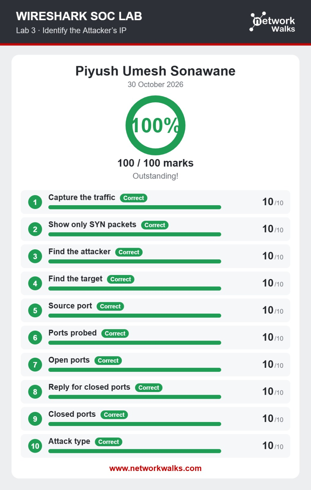
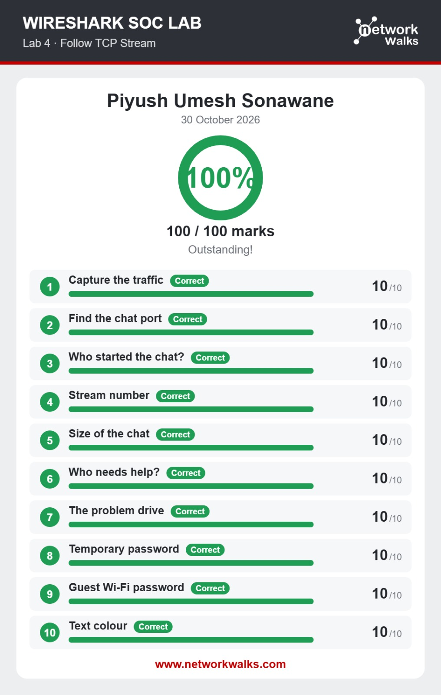
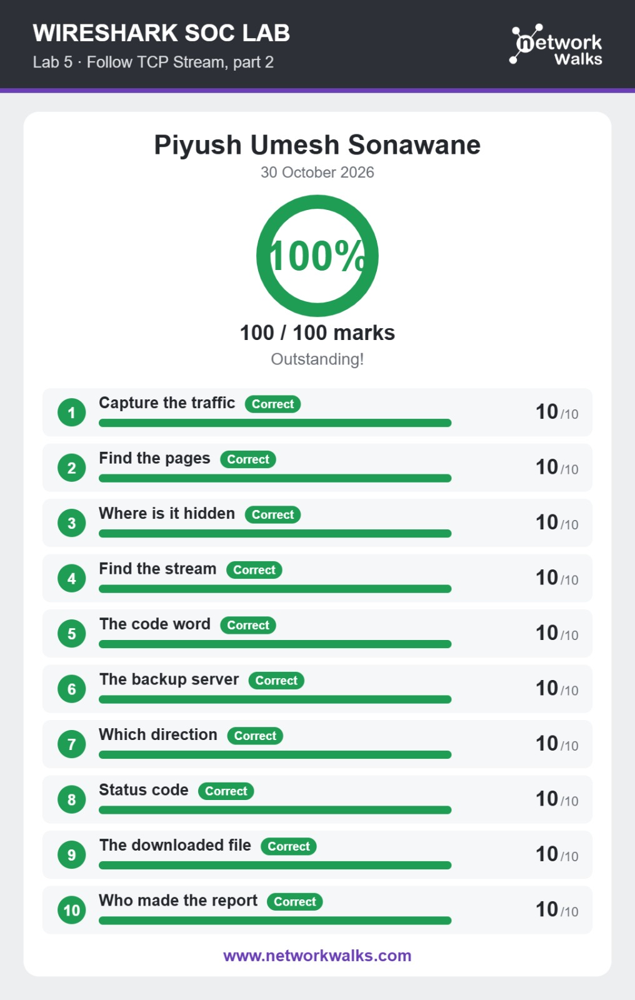
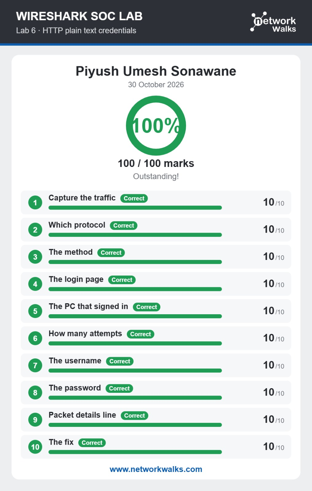
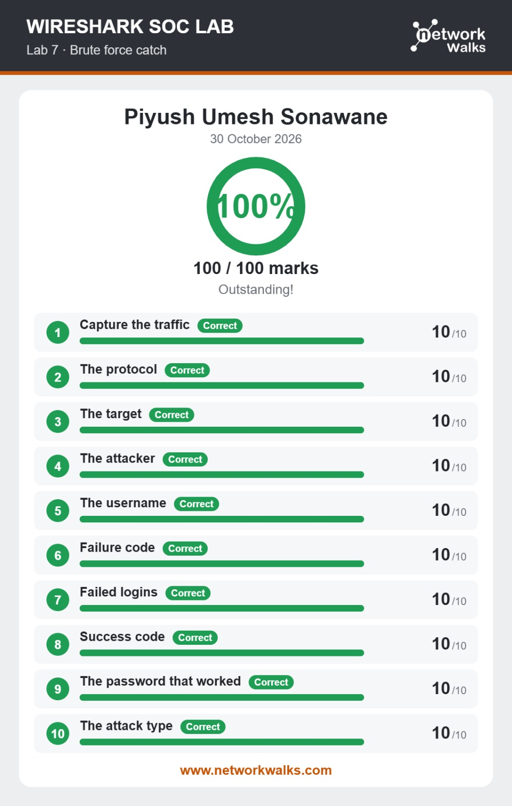
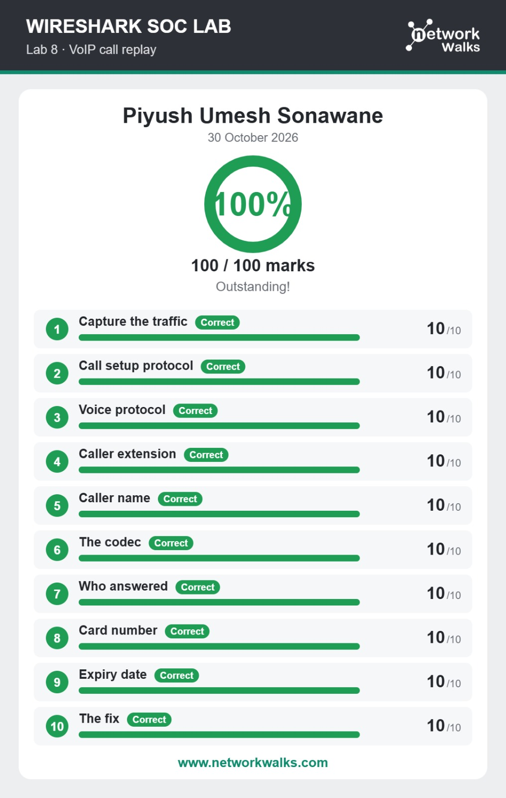

<h1 align="center">🦈 Wireshark SOC Labs</h1>

<i>Week 1 extra task: reading packet captures the way a SOC analyst does.</i>

  
  
  
  

> **Networkwalks Cybersecurity Internship** · Week 1 · Extra task
> **Intern:** Piyush Sonawane · **Batch:** B084B

---

## 📌 Overview

Alongside the lab setup project, I completed a set of **Wireshark SOC labs** from Networkwalks. In each lab the goal is the same as in a real Security Operations Center: take a packet capture, find what happened, and answer questions about it.

All six labs were completed on **30 October 2026** with a full score on each.

---

## 🏆 Results

| Lab | Topic | Score |
| :-: | :-- | :-: |
| 3 | [Identify the Attacker's IP](#lab-3--identify-the-attackers-ip) | 100 / 100 |
| 4 | [Follow TCP Stream](#lab-4--follow-tcp-stream) | 100 / 100 |
| 5 | [Follow TCP Stream, part 2](#lab-5--follow-tcp-stream-part-2) | 100 / 100 |
| 6 | [HTTP plain text credentials](#lab-6--http-plain-text-credentials) | 100 / 100 |
| 7 | [Brute force catch](#lab-7--brute-force-catch) | 100 / 100 |
| 8 | [VoIP call replay](#lab-8--voip-call-replay) | 100 / 100 |

Every lab has 10 questions worth 10 marks each.

---

## 🔬 Lab breakdown

### Lab 3 · Identify the Attacker's IP

Spotting a **port scan** in a capture: isolating SYN packets, finding the attacker and the target, seeing which ports were probed, which were open, and how closed ports answered.

### Lab 4 · Follow TCP Stream

Using **Follow TCP Stream** to rebuild a conversation between two hosts: finding the chat port, who started it, the stream number and the size of the exchange, then reading the messages themselves.

### Lab 5 · Follow TCP Stream, part 2

A deeper pass over web traffic: locating pages in the capture, finding hidden content, following the right stream, checking traffic direction and HTTP status codes, and recovering a downloaded file.

### Lab 6 · HTTP plain text credentials

Showing why **unencrypted HTTP** is dangerous: finding the login request, the method used, the host that signed in, the number of attempts, and the credentials sent in clear text. The fix is HTTPS.

### Lab 7 · Brute force catch

Recognising a **brute force attack**: identifying the protocol, the attacker and the target, counting failed logins, and finding the response that marks the successful attempt.

### Lab 8 · VoIP call replay

Analysing **VoIP traffic**: the call setup protocol, the voice protocol and codec, caller details, who answered, and what sensitive data was spoken over an unprotected call. The fix is encrypting the call.

---

## 🧰 Quick reference

Filters and features that are useful for labs like these:

| Goal | Wireshark approach |
| :-- | :-- |
| Show only SYN packets (scan detection) | `tcp.flags.syn == 1 && tcp.flags.ack == 0` |
| Find closed-port replies | `tcp.flags.reset == 1` |
| Rebuild a conversation | Right-click a packet → **Follow → TCP Stream** |
| Find form logins | `http.request.method == "POST"` |
| Filter by HTTP status | `http.response.code == 200` |
| Inspect VoIP calls | **Telephony → VoIP Calls**, filters `sip` and `rtp` |

---

## 💡 Key takeaways

- **Scans leave a pattern.** Many SYN packets from one host to many ports, with resets from the closed ones, is the signature of a port scan.
- **Follow TCP Stream saves time.** It turns scattered packets into a readable conversation.
- **Plain text protocols leak.** Credentials sent over HTTP are visible to anyone who can capture the traffic.
- **Brute force is visible.** A burst of failures followed by one success tells the whole story.
- **Voice traffic needs protection too.** Unencrypted VoIP can be replayed and its content recovered.

---

## ⚖️ Ethical use

These labs use training captures for learning. Only capture and analyse traffic on networks you own or have written permission to monitor.

---

[⬅ Back to the Lab Setup project](../README.md)
